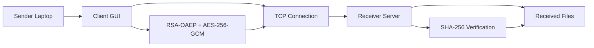

# SecureLAN

**A LAN-based secure file transfer application built with Python, TCP sockets and modern cryptography.**

SecureLAN is a client-server file transfer application that allows two computers on the same local network to exchange files through two modes: Normal and Secure.

The project demonstrates how encryption, key exchange, file integrity verification and server identity verification can improve the security of file transfers. It also compares both modes through Wireshark traffic analysis and performance measurements.

## Features

- **TCP File Transfer:** Transfer files between two computers connected to the same Wi-Fi/LAN.
- **Dual Transfer Modes:** Normal mode for plaintext transfer and Secure mode for encrypted transfer.
- **Hybrid Encryption:** RSA-3072 with OAEP and SHA-256 for wrapping AES session keys, combined with AES-256-GCM for file encryption.
- **Server Identity Verification:** Manually verify the receiver's RSA public-key fingerprint using SHA-256.
- **File Integrity Verification:** Compare SHA-256 file digests at the sender and receiver.
- **Graphical Interface:** Separate sender and receiver dashboards built with CustomTkinter.
- **Live Transfer Monitoring:** View transfer progress, speed, elapsed time and activity logs.
- **Wireshark Analysis:** Inspect TCP traffic and compare plaintext and encrypted payloads.

## Technology Stack

| Technology | Purpose |
|---|---|
| Python | Core application |
| TCP Sockets | Client-server communication |
| Multithreading | Handle incoming client connections |
| CustomTkinter | Graphical user interface |
| PyCryptodome | RSA and AES cryptographic operations |
| SHA-256 | Fingerprinting and file digest verification |
| Wireshark | Network traffic inspection and analysis |

## System Architecture

SecureLAN follows a client-server architecture. The receiver listens for incoming TCP connections, while the sender connects using the receiver's LAN IPv4 address and port.

### Architecture Diagram



### Secure Transfer Workflow

1. The receiver starts the server and loads or generates its RSA-3072 key pair.
2. The sender connects to the receiver through TCP.
3. The receiver sends its public key to the sender.
4. The sender calculates the public-key fingerprint and compares it with the fingerprint manually obtained from the trusted receiver.
5. The sender generates a fresh AES-256 session key.
6. RSA-OAEP with SHA-256 wraps the AES session key.
7. AES-256-GCM encrypts and authenticates the file content.
8. The receiver unwraps the AES key using its RSA private key and decrypts the file.
9. The receiver verifies the SHA-256 file digest before saving the completed file.

In Normal mode, the file is transferred without encryption for controlled comparison.

## Normal Mode vs Secure Mode

| Feature | Normal Mode | Secure Mode |
|---|---|---|
| TCP Communication | Yes | Yes |
| File Encryption | No | AES-256-GCM |
| Key Wrapping | Not required | RSA-OAEP |
| Server Fingerprint Verification | Not required | Yes |
| File Digest Verification | Yes | Yes |
| Payload Visibility | Plaintext | Encrypted |

## Performance Evaluation

The application was tested using 1 MB, 10 MB and 50 MB files over a local network.

### Observed Benchmark Results

| File Size | Mode | Transfer Time | Throughput |
|---|---|---:|---:|
| 1 MB | Normal | 0.30 s | 3.29 MB/s |
| 1 MB | Secure | 0.42 s | 2.37 MB/s |
| 10 MB | Normal | 2.77 s | 3.60 MB/s |
| 10 MB | Secure | 3.18 s | 3.14 MB/s |
| 50 MB | Normal | 13.20 s | 3.79 MB/s |
| 50 MB | Secure | 12.58 s | 3.97 MB/s |

These are observed results from the project testing environment, not guaranteed performance figures.

The Secure mode was slower for the 1 MB and 10 MB tests but slightly faster in the 50 MB test. This demonstrates why repeated controlled experiments are important before drawing conclusions about cryptographic overhead.

## Wireshark Analysis

Wireshark was used to inspect network traffic and understand how the two transfer modes differ.

Useful display filters:

**1. Filter SecureLAN traffic**
```text
tcp.port == 5000
```

**2. Identify TCP retransmissions**
```text
tcp.port == 5000 && tcp.analysis.retransmission
```

**3. Inspect TCP conversations**

Use Statistics → Conversations → TCP to inspect communicating endpoints, packet counts and transferred bytes.

**4. Follow TCP Stream**

Compare Normal and Secure transfers to observe the difference between plaintext and encrypted file payloads.

Even in Secure mode, some information remains observable, including IP addresses, TCP ports, packet sizes, timing, traffic volume and protocol metadata such as filenames and file sizes.

## Installation and Setup

### Requirements

- Windows 10/11
- Python 3.10 or later
- Two computers connected to the same Wi-Fi/LAN
- Wireshark (optional, for traffic analysis)

### 1. Clone the Repository

```bash
git clone https://github.com/YOUR_USERNAME/SecureLAN.git
cd SecureLAN
```

### 2. Install Dependencies

```bash
py -m pip install -r requirements.txt
```

### 3. Start the Receiver

On the receiver laptop:

```bash
py server.py
```

1. Click **START SERVER**.
2. Note the displayed LAN IPv4 address and port.
3. Copy the displayed server public-key fingerprint.

The application automatically generates an RSA-3072 key pair on the first server initialization and reuses the existing keys on subsequent runs.

### 4. Start the Sender

On the sender laptop:

```bash
py client.py
```

1. Enter the receiver's LAN IP address and port.
2. Select a file to transfer.
3. Choose Normal or Secure mode.
4. For Secure mode, enter the fingerprint obtained from the receiver.
5. Click **SEND FILE**.

Successfully received files are saved in the `received_files/` directory on the receiver laptop.

If Windows Firewall prompts for network access, allow Python on Private networks only.

## Project Structure

```text
SecureLAN/
│
├── client.py           # Sender GUI and transfer logic
├── server.py           # Receiver GUI and server logic
├── common.py           # Shared networking and utility functions
├── crypto_utils.py     # RSA and AES cryptographic functions
│
├── captures/           # Wireshark capture storage
├── received_files/     # Received files
├── logs/               # Runtime logs
│
├── requirements.txt    # Python dependencies
├── .gitignore
└── README.md
```

## Security Considerations

SecureLAN is an educational project and a demonstration of cryptographic concepts, not a production-ready file transfer service.

- Normal mode intentionally transfers file content without encryption and should only be used with harmless demonstration data.
- Secure mode uses RSA-OAEP and AES-256-GCM to protect file content.
- Server identity verification relies on manually obtaining and checking the receiver's public-key fingerprint through a trusted channel.
- File metadata is not fully encrypted or independently authenticated by the current protocol.
- The application does not implement TLS or forward secrecy.
- The RSA private key must remain local to the receiver and must never be shared or committed to version control.

## Future Improvements

- Integrate TLS for standardized transport security.
- Explore ephemeral Diffie-Hellman key exchange to support forward secrecy.
- Improve protocol metadata authentication and validation.
- Add automated unit and integration tests.
- Improve error handling and concurrent transfer management.
- Add more detailed performance testing under controlled network conditions.

## Learning Outcomes

Through SecureLAN, the project explores:

- TCP client-server communication and socket programming.
- Multithreading and concurrent connection handling.
- Hybrid encryption using RSA and AES.
- File integrity verification using SHA-256.
- Public-key fingerprint verification.
- Wireshark packet analysis and TCP retransmissions.
- Performance comparison of encrypted and plaintext file transfers.
